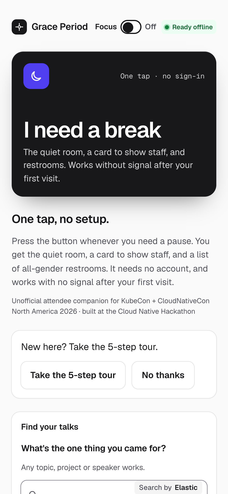
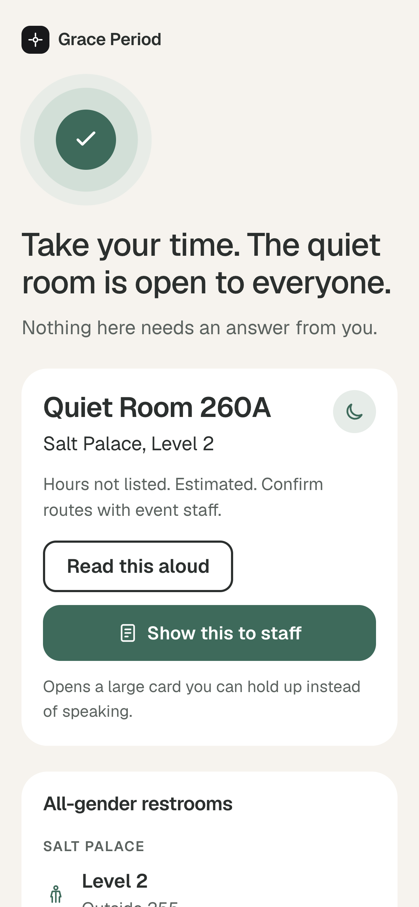
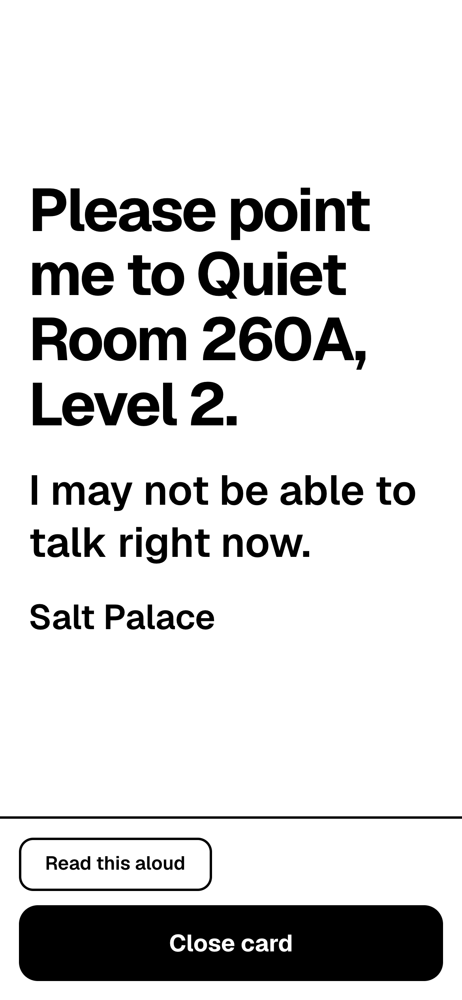
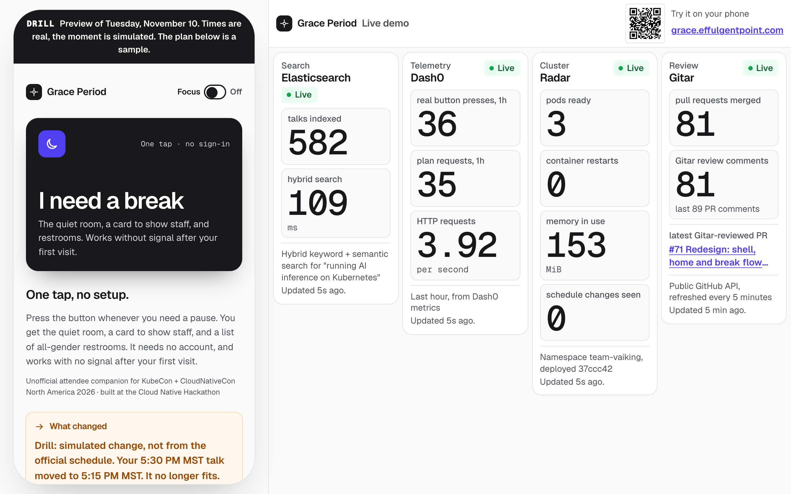
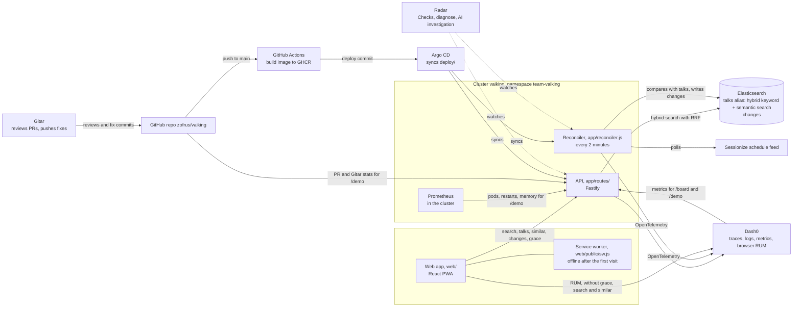

# Grace Period

**A phone app for KubeCon attendees who need a break: one button with zero setup, and a day plan that keeps itself in line with the real schedule.** Built by team vAIking at the Cloud Native Hackathon, November 9, 2026.

- App: <https://grace.effulgentpoint.com>
- Judge view, the app beside four live tool columns: <https://grace.effulgentpoint.com/demo>
- Organizer board, counts only: <https://grace.effulgentpoint.com/board>

## Why it's different

- **Care in one tap.** For the attendee who is overwhelmed: one large "I need a break" button, no account, no plan and no reason asked. It shows the quiet room, the all-gender restrooms and a card to show staff.
- **Works when the venue network doesn't.** After the first visit the button works offline, and the app installs on a phone.
- **Your day, reconciled like a Kubernetes controller.** You declare what you came for. A reconciler compares the real schedule with it every 2 minutes, and the app tells you in one plain sentence what moved, what still fits, and the closest talk you can still reach. No real schedule change has appeared in the feed yet today, so the moved-talk notice is shown in preview mode as a labelled DRILL.
- **Four sponsor tools, live.** [/demo](https://grace.effulgentpoint.com/demo) shows the app next to live numbers from Elasticsearch, Dash0, Radar and Gitar.

## Try it

Open <https://grace.effulgentpoint.com> on your phone. No account, no install needed.

<!-- TODO: Builder A is generating docs/qr-grace.svg. When it is in the repo, replace this comment with:

-->

## 30-second tour

1. Open <https://grace.effulgentpoint.com> on a phone and press **I need a break**: Quiet Room 260A, the all-gender restrooms and **Show this to staff**, with no sign-up.
2. Open the staff card, then **Close card** and **Back to the start**.
3. Under **Find your talks**, search for what you came for (try "kubernetes"). Each result says whether it matched your words or your meaning. Mark one **Must-see**.
4. Read **Your day**, and turn on **Show as kubectl** to see the same facts as `kubectl get` and `describe` output.
5. Open the [preview of Tuesday](https://grace.effulgentpoint.com/?preview=2026-11-10T15:25:00-07:00&sample=1) for a sample saved plan, labelled as simulated, and press the button there. Then open [/demo](https://grace.effulgentpoint.com/demo).

Screenshots from the live app, Nov 9, 2026, 3:52 PM MST:

<p>
  
  
  
</p>



## Features

Everything below is merged and live.

- **A new look.** Redesigned "Your day", kubectl view and plan search ([#70](https://github.com/zofrus/vaiking/pull/70), [#81](https://github.com/zofrus/vaiking/pull/81)), and a redesigned organizer board and live demo ([#75](https://github.com/zofrus/vaiking/pull/75), [#78](https://github.com/zofrus/vaiking/pull/78)). The home screen and break flow were redesigned in [#71](https://github.com/zofrus/vaiking/pull/71).
- **Focus mode.** Fewer things on screen, no motion and larger text. It's a display choice saved on this phone ([#69](https://github.com/zofrus/vaiking/pull/69)).
- **Easier-to-read font.** A switch inside Focus mode to Atkinson Hyperlegible, bundled so it works offline ([#80](https://github.com/zofrus/vaiking/pull/80)).
- **KubeCon communication sticker card.** Choose the sticker you picked up at registration, and the card shows the event's own words. Green: "Open to communicate." Yellow: "Only if you know me, please." Red: "I’m not interested in communicating (or being videotaped or photographed) at this time." Source: KubeCon + CloudNativeCon NA 2026 Inclusion + Accessibility page, checked Nov 9, 2026. The choice stays on the phone ([#64](https://github.com/zofrus/vaiking/pull/64)).
- **Sourced venue facts.** The calm screen's quiet room, restrooms and first aid come from the event's [Inclusion + Accessibility page](https://events.linuxfoundation.org/kubecon-cloudnativecon-north-america/attend/inclusion-accessibility/), with the source line shown ([#67](https://github.com/zofrus/vaiking/pull/67)).
- **Read aloud.** The calm screen and the staff card can read their words out with the phone's own voice ([#72](https://github.com/zofrus/vaiking/pull/72)).
- **Breathing guide and background sound.** Box breathing (in 4, hold 4, out 4, hold 4) with the words and a count always on screen, and quiet background sound ([#72](https://github.com/zofrus/vaiking/pull/72)). They sit together under **More support** ([#71](https://github.com/zofrus/vaiking/pull/71)).
- **Calendar reminders.** Add your day to your calendar. The file is built on the phone with no request, and each talk gets reminders 10 and 2 minutes before ([#74](https://github.com/zofrus/vaiking/pull/74)).
- **A 5-step tour you can replay** from the home screen at any time ([#73](https://github.com/zofrus/vaiking/pull/73)).
- **Labelled drill.** In preview mode, a simulated reschedule is marked "Drill · simulated", and its notice starts "Drill: simulated change, not from the official schedule." ([#63](https://github.com/zofrus/vaiking/pull/63)).
- **Honest offline chip.** "Ready offline" once the app is cached, and "Offline. The break button still works." when the connection drops ([#66](https://github.com/zofrus/vaiking/pull/66)).
- **Share by QR.** [/demo](https://grace.effulgentpoint.com/demo) shows a QR code that opens <https://grace.effulgentpoint.com> on a phone ([#47](https://github.com/zofrus/vaiking/pull/47)).
- **Feels like a real app.** It installs to the home screen, with an icon, a manifest and a share image ([#45](https://github.com/zofrus/vaiking/pull/45), [#76](https://github.com/zofrus/vaiking/pull/76)).

## Accessibility

What we check, and where it lives:

- **axe in CI on every pull request.** [`web/scripts/axe.mjs`](web/scripts/axe.mjs) runs axe against WCAG 2.0, 2.1 and 2.2 A and AA rules on 13 page states of the built app: home, calm screen, staff card, the sample plan, the board, the first-visit tour, and Focus mode with and without the readable font. It runs in [`.github/workflows/ci.yml`](.github/workflows/ci.yml) ([#22](https://github.com/zofrus/vaiking/pull/22)).
- **A review gate.** Gitar reports accessibility problems as blocking findings under rules we wrote in [`.gitar/review/accessibility.md`](.gitar/review/accessibility.md). Audit fixes are in [#42](https://github.com/zofrus/vaiking/pull/42).
- **Reduced motion.** The app honours `prefers-reduced-motion` ([`web/src/index.css`](web/src/index.css), [`web/src/day.css`](web/src/day.css)), and Focus mode turns motion off ([#69](https://github.com/zofrus/vaiking/pull/69)).
- **200% zoom and narrow screens.** Checked on the live site on Nov 9, 2026 at 15:52 MST: no horizontal scrolling at 640 CSS pixels wide (1280 by 800 at 200% zoom) or at 320 pixels, on the home screen, calm screen, staff card and board. The method is in the pull request that added this line.
- **Screen-reader names.** Each talk's buttons carry the talk's name ([#37](https://github.com/zofrus/vaiking/pull/37)), and search results are announced ([#35](https://github.com/zofrus/vaiking/pull/35)).
- **No colour-only meaning.** Sticker colours always come with the word ([`web/src/Sticker.tsx`](web/src/Sticker.tsx)), the breathing guide always shows words and a count ([`web/src/Breathe.tsx`](web/src/Breathe.tsx)), and /demo statuses are words, not dots ([`web/src/pages/Demo.tsx`](web/src/pages/Demo.tsx)).
- **Venue facts verbatim and sourced.** Sticker wording and venue facts are copied from the event's page, with a source line and the date checked ([`web/src/lib/sticker.ts`](web/src/lib/sticker.ts), [`web/src/data/facilities.ts`](web/src/data/facilities.ts), [#64](https://github.com/zofrus/vaiking/pull/64), [#67](https://github.com/zofrus/vaiking/pull/67)).

## How it fits together



| Part | Where | What it does |
|---|---|---|
| Web app | `web/` | React phone UI, built into the server's image. The button path never waits on the network. |
| API server | `app/server.js`, `app/routes/` | Fastify. Each file in `app/routes/` is an auto-loaded route. |
| Reconciler | `app/reconciler.js`, `deploy/reconciler.yaml` | Second Deployment on the same image. Every 2 minutes it compares the Sessionize feed with the `talks` index and records what moved. |
| Search and data | Elasticsearch | `talks` (hybrid keyword and semantic search) and `changes`, which the reconciler writes. |
| Facilities | `web/src/data/facilities.ts`, `app/data/facilities.json` | The quiet room and restrooms are bundled with the app, not read from Elasticsearch, so the break screen works offline. The phone uses its own copy, and `/api/facilities` serves the JSON copy. `scripts/ingest-facilities.mjs` can also load them into a `facilities-v1` index, which the app does not read. |
| Telemetry | OpenTelemetry to Dash0 | Traces, logs and metrics. Attendee identity and access needs stay out of them. |
| Delivery | `deploy/`, Argo CD, Radar | A push to `main` builds an image, and Argo CD syncs the `team-vaiking` namespace. |

The public address, <https://grace.effulgentpoint.com>, is a proxy in front of the team cluster's own address, <https://vaiking.cnh.radarhq.io>, which the platform routes to Service `app` in `team-vaiking`. Both serve the same build.

Semantic search through Elasticsearch's embeddings is the only AI in the product. Nothing on the break-button path calls a model.

## Sponsor tools: evidence

| Tool | What we used it for | Evidence |
|---|---|---|
| Elasticsearch | The data layer. 582 talks in the `talks` alias with hybrid search: typo-tolerant keyword search plus `semantic_text` embeddings, fused with RRF, with facets and per-result match reasons. Also the reconciler's `changes` index. Facilities are bundled with the app instead, so the break screen works offline. | [`app/lib/search.js`](app/lib/search.js), [`scripts/ingest-sessionize.mjs`](scripts/ingest-sessionize.mjs), PRs [#6](https://github.com/zofrus/vaiking/pull/6), [#34](https://github.com/zofrus/vaiking/pull/34) and [#15](https://github.com/zofrus/vaiking/pull/15), and the Elasticsearch column on [/demo](https://grace.effulgentpoint.com/demo) |
| Dash0 | OpenTelemetry traces, logs and metrics from the API and the reconciler, browser RUM, and metrics read back for `/board` and `/demo`. Agent0 found a false error report in our browser telemetry. | [`app/otel.js`](app/otel.js), [`web/src/telemetry.ts`](web/src/telemetry.ts), [`dash0/README.md`](dash0/README.md), PRs [#16](https://github.com/zofrus/vaiking/pull/16) and [#48](https://github.com/zofrus/vaiking/pull/48), the [Agent0 note on #38](https://github.com/zofrus/vaiking/pull/38#issuecomment-6751879772), and the Dash0 column on [/demo](https://grace.effulgentpoint.com/demo) |
| Radar | Watching GitOps deploys to `team-vaiking`. Checks went from 4 medium findings to 1, `diagnose` found a real crash loop in one call, and the AI investigation is told honestly, including that it was wrong. | [`STORY.md`](STORY.md), PRs [#19](https://github.com/zofrus/vaiking/pull/19), [#23](https://github.com/zofrus/vaiking/pull/23), [#27](https://github.com/zofrus/vaiking/pull/27) and [#40](https://github.com/zofrus/vaiking/pull/40), and the Radar column on [/demo](https://grace.effulgentpoint.com/demo) |
| Gitar | Reviews our pull requests against rules we wrote in [`.gitar/`](.gitar/), and pushes fix commits that we read before merging. | [How Gitar was used to build this](#how-gitar-was-used-to-build-this), the [Gitar review on #13](https://github.com/zofrus/vaiking/pull/13#issuecomment-6750912301), fix commit [c4ef373](https://github.com/zofrus/vaiking/commit/c4ef373), and the Gitar column on [/demo](https://grace.effulgentpoint.com/demo) |

## Who it helps

Conferences are loud, long and crowded, and some people need to step away without having to explain why. Grace Period is built for that moment.

- **A break with nothing to fill in.** The "I need a break" button needs no account, no plan and no reason. The app asks what helps, never what someone has: no diagnosis words and no disability checkboxes.
- **Something to show instead of explaining.** A card for event staff, for anyone who finds it hard to say what they need right then.
- **Places, stated honestly.** It names Quiet Room 260A, which is open to everyone, and the venue's all-gender restrooms, transcribed from the event's accessibility page. With no location signal it never says "the nearest". Hours show as "Hours not listed" until someone verifies them, and directions say "Estimated. Confirm routes with event staff."
- **Your plan is kept.** A press sets aside the nice-to-have talks before your next must-see. Nothing is cancelled, and "Put them back" restores them.
- **Works in a crowded venue.** After the first visit the app keeps working offline, so the button still works when the signal is poor.
- **Accessible by default.** Real headings, a skip link, keyboard support and aria-live announcements. CI runs an axe accessibility check on the built app, and Gitar reviews our PRs against [accessibility rules we wrote](.gitar/review/accessibility.md).

## Run it yourself

You need Node 22 or newer. Elasticsearch and Dash0 are optional. Without them the app still starts: `/api/search`, `/api/talks`, `/api/similar` and `/api/changes` answer 503 with a JSON error, while the break button, `/api/facilities` and `/api/board` keep working.

Run the API and the UI in two terminals, each starting from the repo root:

```bash
# Terminal 1: the API on http://localhost:8080. It serves /healthz, /readyz and /api/*, not the UI.
cd app && npm ci && npm test && npm start
```

```bash
# Terminal 2: the UI. Open http://localhost:5173. It sends /api calls to localhost:8080.
cd web && npm ci && npm run dev
```

To check the code the way CI does, from the repo root:

```bash
(cd app && npm ci && npm run lint && npm test)
(cd web && npm ci && npm run lint && npm test && npm run build)
```

To run the complete image, as production does (this is also how to see the UI on port 8080):

```bash
docker build -t grace-period .
docker run --rm -p 8080:8080 grace-period
```

Then, in another terminal:

```bash
curl localhost:8080/healthz                                   # ok
curl localhost:8080/readyz                                    # ok
curl -s -o /dev/null -w '%{http_code}\n' localhost:8080/      # 200, the web app
```

Connecting Elasticsearch needs two environment variables, which also let you load the data:

```bash
export ELASTICSEARCH_URL=...      # never commit these
export ELASTICSEARCH_API_KEY=...
node scripts/ingest-sessionize.mjs   # add --dry-run to preview without Elasticsearch
node scripts/ingest-facilities.mjs
cd app && node reconciler.js         # optional: the schedule loop
```

To deploy on a cluster, create Secret `app-credentials` in the app's namespace with the keys `elasticsearch-url`, `elasticsearch-api-key`, `otlp-endpoint`, `dash0-auth-token`, `rum-endpoint`, `rum-token`, `dataset`, `dash0-read-token` and `dash0-api-url`, then apply `argocd/application.yaml`. Every key is optional, so pods start without it.

The hackathon's notes on the team cluster (Radar, Argo CD, kubectl, a local cluster) are in [docs/RADAR-STARTER.md](docs/RADAR-STARTER.md). You don't need them to run the app.

## How Gitar was used to build this

Gitar reviewed our pull requests against rules we wrote for this product in [`.gitar/review/`](.gitar/review/) and [`.gitar/rules/`](.gitar/rules/): no personal data in telemetry, times always show a time zone, an accessible UI, and a span for every endpoint. [`.gitar/config/apply.md`](.gitar/config/apply.md) lets it push fixes for some kinds of findings, and it pushed each fix commit below itself. We read every Gitar commit before merging.

| PR | What Gitar found | Gitar's fix commit | CI and review |
|---|---|---|---|
| [#13 Grace route security fixes](https://github.com/zofrus/vaiking/pull/13) ([review](https://github.com/zofrus/vaiking/pull/13#issuecomment-6750912301)) | Security: the server span for `/api/grace` still exported the client IP and User-Agent, which would link an identifier to a break request. Our review rules forbid that. | [c4ef373](https://github.com/zofrus/vaiking/commit/c4ef373) "fix: omit grace requests from server spans" | [Passed](https://github.com/zofrus/vaiking/actions/runs/42695192084) on c4ef373. Gitar approved, 1 of 1 finding closed. |
| [#12 Plan timing metric, /api/board and Board page](https://github.com/zofrus/vaiking/pull/12) ([review](https://github.com/zofrus/vaiking/pull/12#issuecomment-6751125861)) | Bug: if Dash0 failed after one success, `/api/board` served old counts with no age limit and no stale marker, so the page kept saying "last hour" for old numbers. | [fe436e2](https://github.com/zofrus/vaiking/commit/fe436e2) "fix: mark stale board counts" | [Passed](https://github.com/zofrus/vaiking/actions/runs/42694283040) on fe436e2. Gitar approved, 1 of 1 closed. |
| [#16 Dash0 read path fix, RUM exclusion](https://github.com/zofrus/vaiking/pull/16) ([review](https://github.com/zofrus/vaiking/pull/16#issuecomment-6751308642)) | Two bugs: the board's sample note said "Small sample: 0 presses" when only preview data existed, and the Board page was never mounted, so nobody could reach it. | [61c89de](https://github.com/zofrus/vaiking/commit/61c89de) "fix: expose organizer board and clarify sample note" | [Passed](https://github.com/zofrus/vaiking/actions/runs/42696093291) on the next commit after the fix. Gitar approved, 2 of 2 closed. |
| [#22 Axe accessibility check in CI and grace-path review rules](https://github.com/zofrus/vaiking/pull/22) ([review](https://github.com/zofrus/vaiking/pull/22#issuecomment-6751267272)) | Five findings. One was blocking under our rules: change notices showed talk times with no time zone. The others: a wrong "only talk numbers are sent" privacy line, an unchecked buffer input, no suggestion on empty search results, and catch blocks that swallowed errors. | [fa79a3c](https://github.com/zofrus/vaiking/commit/fa79a3c) "fix: address web review findings" (7 files) | Failed earlier on this PR (see below), then [passed](https://github.com/zofrus/vaiking/actions/runs/42697722465) before merge. Gitar approved, 5 of 5 closed. |
| [#25 Privacy and honesty: search text copy, logs, telemetry](https://github.com/zofrus/vaiking/pull/25) ([review](https://github.com/zofrus/vaiking/pull/25#issuecomment-6751313843)) | No findings. Gitar checked it against our three rules (accessible UI, instrumented endpoints, no private data) and approved. | None needed | Merged with Gitar's approval. |

The one CI failure: [run 42695403818](https://github.com/zofrus/vaiking/actions/runs/42695403818) on PR #22 failed at job `verify`, step "Lint web", because the new axe script under `web/scripts` used Node globals that eslint was not configured for. We fixed it by hand in [a146970](https://github.com/zofrus/vaiking/commit/a146970) at 20:46:57 UTC, and CI went [green](https://github.com/zofrus/vaiking/actions/runs/42696238736). Gitar pushed the identical one-file fix, [f8bf65d](https://github.com/zofrus/vaiking/commit/f8bf65d), about four minutes later at 20:50:45 UTC.

## AI use

AI agents wrote most of the code in this repo. I directed the work, reviewed it, ran the acceptance tests and decided what merged.

**What I did myself.**
- Chose the problem and the product: Grace Period, a break button for overwhelmed attendees. Then kept steering. I pushed back on a search-only app, asked for the kubectl day view and the four-tools demo page, called a redesign at 2:52 PM after realizing, on my way to a bio break, that other teams were probably building similar search apps, and picked the Pro Product design out of five. I asked for Focus mode, calendar transition reminders, a replayable tour, background sound and breathing, read aloud, and neurodivergent-friendly defaults.
- Set up every account and integration: this GitHub repo and its Actions (enabled for this repo only), Elastic Cloud Serverless, Dash0, the Radar cluster and Argo CD GitOps, Gitar, a Vercel proxy and Cloudflare DNS for grace.effulgentpoint.com, and Google Drive for the video.
- Approved the merges and the security trade-offs. Tested on my phone and in the room.
- Built the setup the agents ran on: two of my Macs, linked over Tailscale and SSH.

**How the AI was used.** Claude Code ran as a coordinator over parallel agent sessions on both Macs, sharing a work board, session logs and a watchdog. A merge loop merged only pull requests with green CI. Forge agents did intake, a devil's-advocate review, planning, building in separate clones, accessibility and code-review gates, and merge resolution. Research agents read the rules and sponsor docs. A design agent drew five directions. AI-assisted commits carry a `Co-Authored-By` line naming the model.

Gitar reviewed 78 of our 81 merged pull requests against our rules and pushed fixes under its own name ([How Gitar was used](#how-gitar-was-used-to-build-this)). I read each fix before merging. One would have wiped the search index on an empty feed. Dash0's Agent0 found a false error report in our browser telemetry. Radar's AI investigation called a crash loop "transient". Radar's `diagnose` and the pod logs found the real cause ([STORY.md](STORY.md)).

**In the product.** The only AI is semantic search: Elasticsearch embeds talk titles and abstracts. No language model is called, and nothing on the break-button path uses AI.

**Guardrails I set.**
- No secrets in chat or the repo. Keys live in a cluster Secret I applied myself.
- Venue facts are quoted verbatim with a source and date. A test fails without them.
- Anything simulated, including the drill, is labelled on screen.
- A break press sends a floor and a mode. Counts only, nothing identifying.
- No force pushes, rebases or `rm`. A local hook blocks them.
- Accessibility gates: axe in CI and an accessibility review on UI changes.

## Credits

Schedule data: KubeCon + CloudNativeCon North America 2026, The Linux Foundation, CC BY 3.0.
